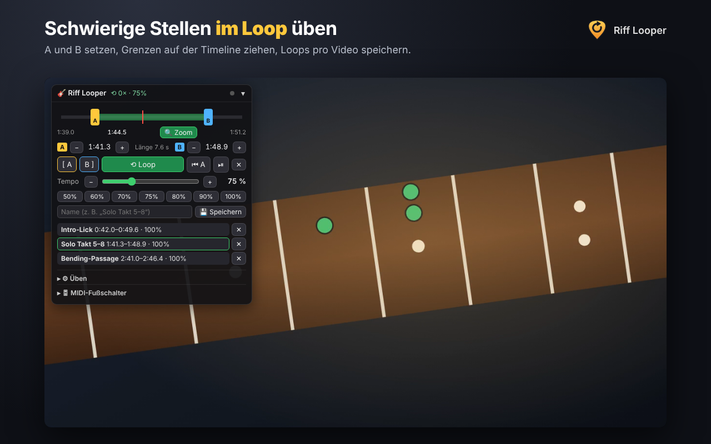

<p align="center"></p>

<h1 align="center">Riff Looper</h1>
<p align="center"><b>Gitarren-Loops für YouTube · Guitar loops for YouTube</b><br>
A/B-Loop · Tempo · Speed-Trainer · MIDI-Fußschalter</p>



**Deutsch** · [English](#english)

Riff Looper ist eine Browser-Erweiterung für Chrome, Edge und Brave. Sie legt ein Übungs-Panel direkt in den YouTube-Player. Damit spielst du schwierige Stellen in Dauerschleife, verlangsamst sie ohne Tonhöhenänderung und steuerst alles mit einem MIDI-Fußschalter, damit die Hände an der Gitarre bleiben.

## Funktionen
- **A/B-Loop**: Grenzen per Knopf, Taste oder Fußschalter setzen und auf der eigenen Timeline ziehen. Zoom und Feinkorrektur (±0,1 s) helfen beim genauen Einstellen.
- **Tempo** 25–200 % ohne Tonhöhenänderung, mit Schnellwahl
- **Speed-Trainer**: erhöht das Tempo automatisch nach jeweils N Durchgängen
- **Pause** zwischen den Durchgängen, **A-Vorlauf** als Ausgleich der Reaktionszeit
- **Gespeicherte Loops** pro Video, mit Namen
- **MIDI-Fußsteuerung** mit MIDI-Learn (CC, Note, Program Change; Taster oder rastend), Smart-Taste für Ein-Schalter-Setups, Expression-Pedal → Tempo
- **Tastaturkürzel** mit Alt/⌥
- Kein Tracking, keine Server, keine Anmeldung (siehe [Datenschutz](PRIVACY.md))

## Installation
- **Chrome Web Store:** *(Link folgt nach der Freigabe)*
- **Edge Add-ons:** *(Link folgt nach der Freigabe)*
- **Manuell:** Unter [Releases](../../releases) die ZIP-Datei laden und entpacken. Dann `chrome://extensions` öffnen, den Entwicklermodus einschalten, „Entpackte Erweiterung laden“ wählen und den entpackten Ordner auswählen.

Die ausführliche Anleitung mit Tipps zur Fußschalter-Belegung steht in **[docs/ANLEITUNG.md](docs/ANLEITUNG.md)**.

## Projektstruktur
```
extension/        Quellcode der Erweiterung (Manifest V3) – wird als ZIP hochgeladen
  content.js      gesamte Logik: Loop, Tempo, Timeline, Speicher, Web MIDI
  looper.css      Aussehen des Panels
  _locales/       Name und Kurzbeschreibung (de, en)
  icons/          16/32/48/128 px
store/            Material für die Stores: Texte, Screenshots, Werbekacheln, Checkliste
  src/            Quellen und Skripte, mit denen Icon, Screenshots und Kacheln erzeugt wurden
docs/             Anleitung und Logo
scripts/build.sh  baut dist/riff-looper-<version>.zip
```

## Entwickeln
1. `extension/` als entpackte Erweiterung laden (siehe oben).
2. Nach Änderungen unter `chrome://extensions` auf ↻ klicken und den YouTube-Tab neu laden.
3. Für eine Veröffentlichung die Version in `extension/manifest.json` erhöhen, `CHANGELOG.md` ergänzen und `./scripts/build.sh` ausführen.

Hinweis: YouTube erzwingt *Trusted Types*. Deshalb wird das DOM ohne `innerHTML` aufgebaut, bitte so beibehalten.

Ideen, Fehler und Fußschalter-Erfahrungen gerne als [Issue](../../issues) melden.

## Lizenz
[MIT](LICENSE) © 2026 Ulrich Hofer. Riff Looper ist ein unabhängiges Projekt und steht in keiner Verbindung zu YouTube oder Google.

---

## English

Riff Looper is a browser extension for Chrome, Edge and Brave. It adds a practice panel to the YouTube player: loop tricky passages, slow them down without changing the pitch, and control everything hands-free with a MIDI foot switch.

**Features:** A/B loop with draggable boundaries, zoom and fine-tuning · tempo 25–200 % (pitch preserved) · speed trainer · pause between repetitions · saved loops per video · MIDI learn (CC/Note/PC, momentary or latching), one-switch "smart button", expression pedal → tempo · keyboard shortcuts (Alt/⌥) · no tracking, no servers ([privacy policy](PRIVACY.md)).

**Install:** from the Chrome Web Store or Edge Add-ons *(links coming soon)*. To install manually, download the ZIP from [Releases](../../releases) and load the unpacked folder via `chrome://extensions` → Developer mode → "Load unpacked".

**Note:** the panel UI is currently in German; an English UI is planned. Contributions are welcome.

**License:** [MIT](LICENSE) © 2026 Ulrich Hofer. Not affiliated with YouTube or Google.
